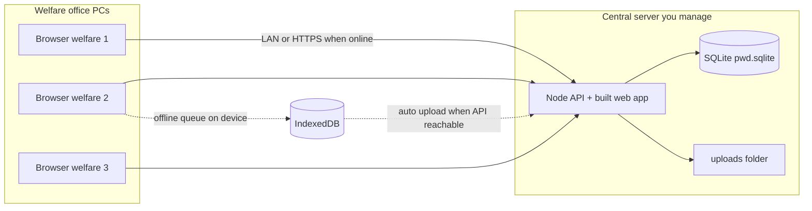

# Hosting PWD Support (one shared database, online + offline registration)

## How it works



- **One server** holds **one database**. Every welfare officer sees the same applicants when connected.
- **Online**: register, edit, applications, reports — all go straight to the server.
- **Offline (registration only)**: the **New Applicant** form saves on that PC (photo included) and **uploads automatically** when the server is reachable again (internet back or office LAN to server restored).
- Staff must **sign in once while online** on each PC; after that, short offline sessions can still register using the cached login.

---

## Step 1 — Choose where the central server lives

| Option | Best for | URL staff use |
|--------|----------|----------------|
| **A. Office server (recommended)** | One assembly, stable LAN | `http://192.168.x.x:4000` or `https://pwd.local` |
| **B. Cloud VM** | Multiple sites or remote oversight | `https://register.yourassembly.gov.gh` |
| **C. Your managed PC** | Pilot / small team | Same as A, you keep backups |

You manage the machine; staff only need the browser link.

---

## Step 2 — Build and deploy the app (you)

On your development PC:

```powershell
cd "C:\Users\Admin\Desktop\PWD System"
npm run package:install
```

Copy `release\PWD-Support-Register-v*-*.zip` to the server, unzip, run `Install.ps1`, then set the app to start on boot (`Start-PWD-Support.bat` or a Windows Service — see `install/MANAGED-DEPLOYMENT.md`).

**Keep on your side:** full source repo, all release zips, backup copies.

---

## Step 3 — Office LAN hosting (works with or without internet)

1. **Server**
   - Windows Server or Windows 10/11 Pro PC on the office network.
   - Install Node 22 LTS.
   - Unzip the release to e.g. `C:\PWD-Support-Register`.
   - Run `Install.ps1`, then `Start-PWD-Support.ps1` (or `.bat`).
   - Windows Firewall: allow inbound **TCP 4000** from **private** profile only.

2. **Static IP** on the server (e.g. `192.168.1.50`).

3. **Staff PCs**
   - Browser bookmark: `http://192.168.1.50:4000`
   - Same URL whether or not the building has internet — as long as LAN reaches the server, everyone shares one database.

4. **Offline scenario**
   - Internet down but **LAN up**: PCs stay online to the server; no queue needed.
   - **Server off** or **Wi‑Fi down**: registration uses offline queue; when LAN/server returns, queued applicants sync to `pwd.sqlite`.

---

## Step 4 — Public HTTPS hosting (optional, for internet access)

Use when staff work from home or you need a public hostname.

1. **Small cloud VM** (2 GB RAM, Ubuntu or Windows).
2. Deploy the same release package; set `PORT=4000` or behind a reverse proxy.
3. **Reverse proxy with TLS** (examples):
   - **Windows**: Caddy or IIS ARR → `https://pwd.yourdomain.gov.gh` → `http://127.0.0.1:4000`
   - **Linux**: Caddy or nginx + Let’s Encrypt
4. Firewall: only **443** (HTTPS) public; block direct access to 4000 from the internet if proxied.
5. Staff bookmark the **HTTPS** URL. Offline registration still works the same way (queue until API is reachable).

---

## Step 5 — Daily operations (you)

| Task | Action |
|------|--------|
| Backup | Copy `backend\data\pwd.sqlite` and `backend\uploads\` daily (see `install/MANAGED-DEPLOYMENT.md`) |
| Updates | New zip → stop app → replace `web\` and backend code → keep `data\` and `uploads\` → restart |
| New staff PC | Open URL, login once online, optional “Install app” from browser (PWA) for faster launch |
| Offline queue stuck | Check yellow bar on screen; verify server running and `/api/health` returns OK |

---

## Step 6 — What welfare staff should know

1. Use the **same link** on every PC (LAN or HTTPS).
2. If the yellow **offline** bar shows, you can still **register new applicants**; they appear for everyone after sync.
3. **Applications, verification, and approval** need the server — use when online.
4. Do not clear browser data on office PCs (it holds login cache and offline queue).

---

## Step 7 — Growing beyond one office

When load or policy requires it (still one logical database):

- Move SQLite → **PostgreSQL** on the same server (same API, different connection string — plan with your implementer).
- Nightly backups to encrypted cloud storage.
- VPN for remote staff instead of exposing admin ports.

---

## Quick checklist

- [ ] Server installed with release zip + `Install.ps1`
- [ ] Fixed LAN IP or HTTPS domain documented for staff
- [ ] Firewall rules set
- [ ] Demo passwords changed
- [ ] Backup job for `pwd.sqlite` + `uploads`
- [ ] You retain source + release archives
- [ ] Staff trained: shared database, offline registration, sync bar
